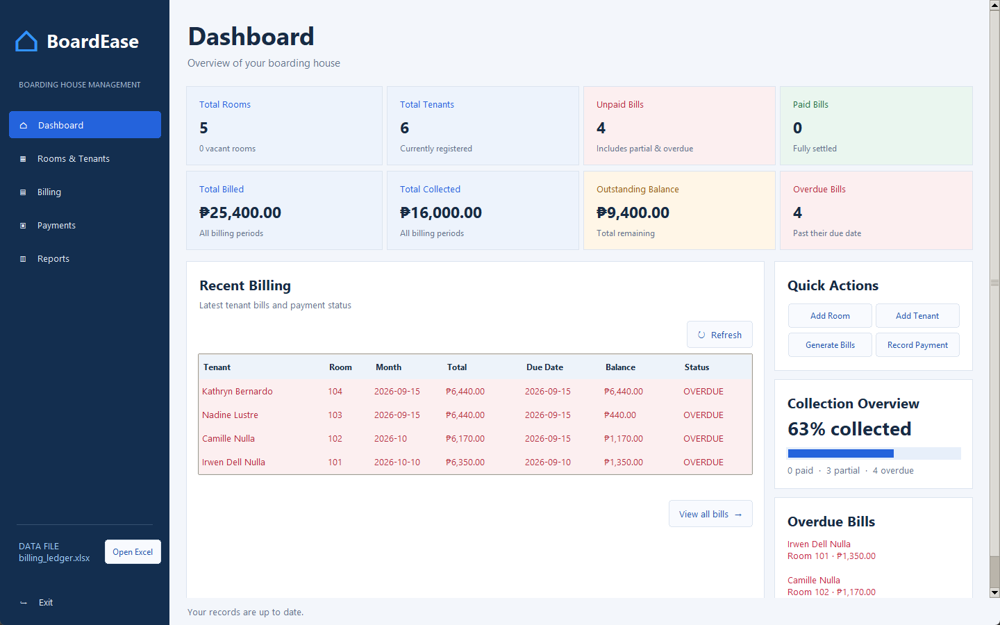
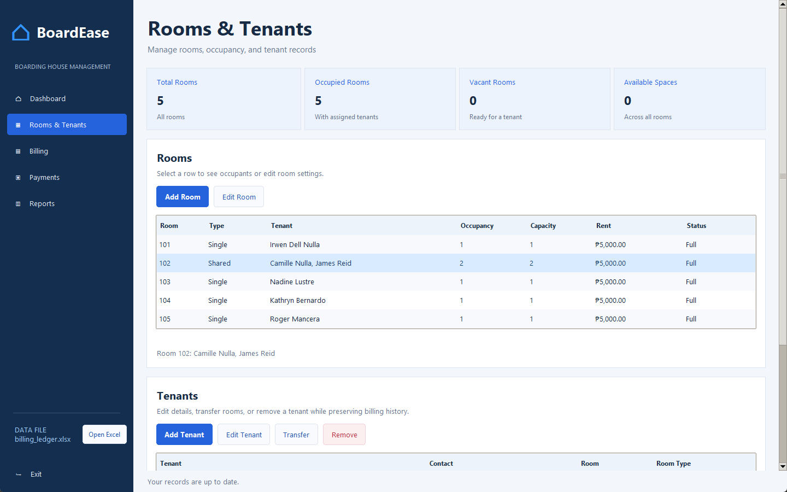
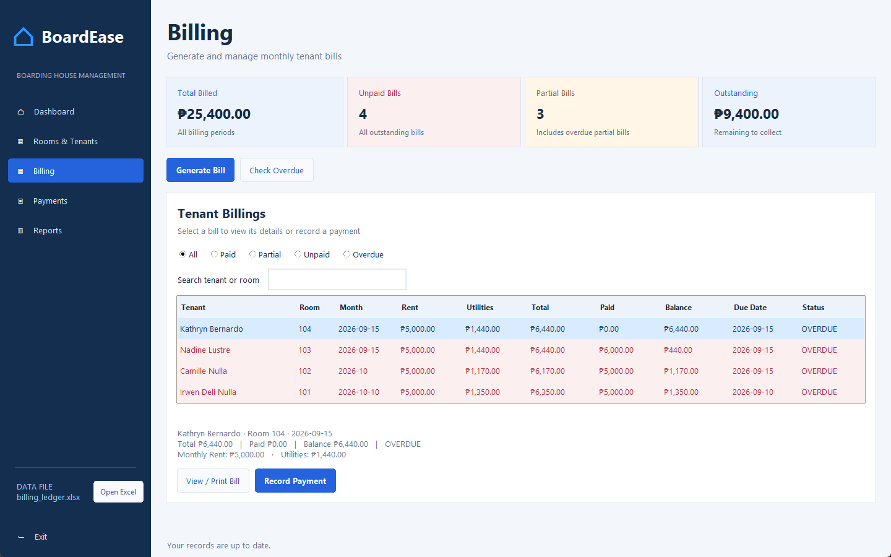
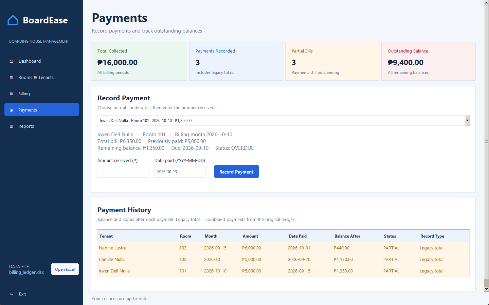
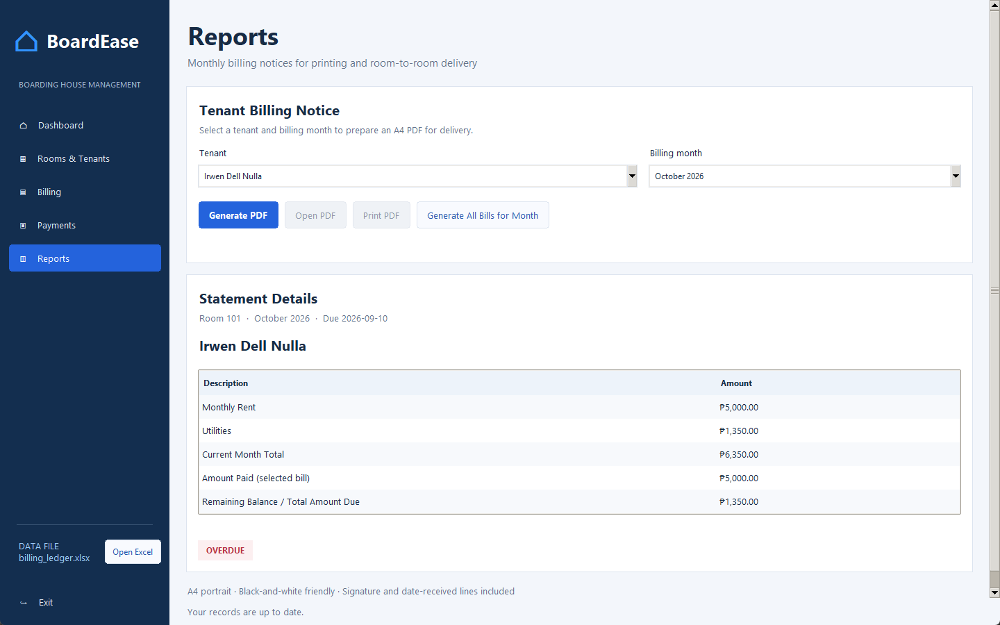

# BoardEase

**Smart Boarding House Billing and Tenant Manager**: a Python desktop app that helps a boarding-house landlord manage rooms, tenants, monthly bills and payments in one place.

BoardEase splits rent, electricity and water fairly among roommates, tracks full and partial payments, flags overdue bills, and prints an A4 billing notice for every tenant. All records are kept in an Excel file (`billing_ledger.xlsx`) that the landlord can open anytime.



## Features

| Feature | What it does |
| --- | --- |
| Rooms and tenants | Single rooms (1 tenant) and shared rooms (2–3 tenants); add, edit, transfer or remove tenants without losing billing history |
| Fair bill splitting | Rent, electricity and water are divided equally among a room's current tenants, exact to the centavo |
| Payment tracking | Full and partial payments, each saved with its date and the balance left after it |
| Overdue checks | Bills past their due date with a balance are flagged **OVERDUE** automatically |
| Billing notices | A printable A4 PDF notice per tenant, or one combined PDF for the whole month |
| Excel records | Every change is saved safely to `billing_ledger.xlsx`, with automatic backups before upgrades |
| Input validation | Dates in `YYYY-MM-DD`, 11-digit unique contact numbers, room capacity limits, no overpayments |

## Screenshots

| Rooms & Tenants | Billing |
| --- | --- |
|  |  |
| **Payments** | **Reports** |
|  |  |

Sample printed notice: [docs/screenshots/billing-notice.png](docs/screenshots/billing-notice.png)

## Getting started (Windows)

Requires Python 3.11 or newer.

```powershell
git clone https://github.com/Idle1705/BoardEase.git
cd BoardEase
python -m venv .venv
.\.venv\Scripts\python.exe -m pip install -r requirements.txt
.\.venv\Scripts\python.exe src\gui_app.py
```

The app opens `billing_ledger.xlsx` in the project folder. To practice without touching the real records, use a separate workbook (a new path starts empty):

```powershell
.\.venv\Scripts\python.exe src\gui_app.py --ledger demo.xlsx
```

Close the workbook in Excel before saving changes in BoardEase.

## How to use it

1. **Rooms & Tenants**: add rooms with their rent and capacity, then add tenants to rooms with space.
2. **Billing**: enter the month's electricity and water readings to generate bills for a room.
3. **Payments**: record full or partial payments; the status updates to PAID, PARTIAL, UNPAID or OVERDUE.
4. **Reports**: generate, open or print each tenant's A4 billing notice.
5. **Dashboard**: see totals, collection progress and overdue bills at a glance.

## Project structure

```
BoardEase/
├── src/
│   ├── gui_app.py          # Tkinter desktop app (the 5 pages and forms)
│   ├── ui_components.py    # Shared buttons, badges and colors
│   ├── boarding_house.py   # BoardingHouse: the controller that applies every rule
│   ├── person.py           # Person (abstract)
│   ├── owner.py            # Owner(Person)
│   ├── tenant.py           # Tenant(Person)
│   ├── room.py             # Room (abstract)
│   ├── single_room.py      # SingleRoom(Room): 1 tenant
│   ├── shared_room.py      # SharedRoom(Room): 2–3 tenants
│   ├── utility_reading.py  # UtilityReading: splits a room's charges
│   ├── bill.py             # Bill, BillingStatement and input validation
│   ├── payment.py          # Payment
│   ├── notification.py     # Reminder and overdue messages (simulated)
│   ├── excel_ledger.py     # ExcelLedger: safe reading and writing of the workbook
│   ├── reports.py          # A4 PDF billing notices
│   └── main.py             # Console demo of the OOP classes
├── tests/                  # 34 automated tests (unittest, run with pytest)
├── docs/
│   ├── screenshots/        # App screenshots used in this README
│   └── data-and-reports.md # How the ledger, backups and PDF notices work
├── billing_ledger.xlsx     # The landlord's records
├── requirements.txt        # openpyxl, reportlab
├── requirements-dev.txt    # pypdf, pytest (for tests)
└── pytest.ini
```

## OOP principles

| Principle | Where it is used |
| --- | --- |
| Abstraction | `Person` and `Room` are abstract classes (`ABC`); only their subclasses can be created |
| Inheritance | `Owner` and `Tenant` extend `Person`; `SingleRoom` and `SharedRoom` extend `Room` |
| Polymorphism | `get_max_occupancy()` returns 1 for a `SingleRoom` and 2–3 for a `SharedRoom`; `get_role()` differs for `Owner` and `Tenant` |
| Encapsulation | `Bill` computes its own balance and status; only `ExcelLedger` reads and writes the Excel file |
| Composition | `BoardingHouse` holds the rooms, bills, payments and one `ExcelLedger` |

## Running the tests

```powershell
.\.venv\Scripts\python.exe -m pip install -r requirements-dev.txt
.\.venv\Scripts\python.exe -m pytest
```

The tests cover billing rules, payments, validation, the Excel ledger and backups, PDF notices, and the desktop screens at four window sizes. Every test uses a temporary workbook, so the real `billing_ledger.xlsx` is never changed. The GUI tests need a desktop display.

To see the OOP classes work without the GUI, run `python src\main.py` (it uses a temporary workbook).

## Tech stack

Python 3 · Tkinter/ttk · openpyxl · ReportLab · unittest/pytest · pypdf

## Team

| Member | Role |
| --- | --- |
| Roger Alfonso Mancera | Front end, back end, UI/UX |
| Irwen Nulla | Project manager, system manager, system tester |
